# Concept-LAB Markdown Editor

## Write in markdown. Edit like a document. Ship a PDF

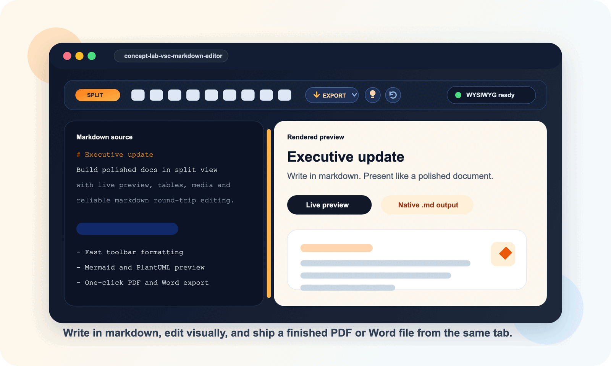

> **Version 1.0.19** · VS Code **1.109+** · Mermaid **11.16.1** · full regression suite green · ships as `.vsix` **and** `.zip`

Concept-LAB is built for teams that still want the portability of markdown, but need an editing experience that feels far more polished than plain text. It brings together visual confidence, production speed, native markdown output, and one-click delivery to PDF and Word in a single VS Code workflow.

Use it when plain markdown editing feels too raw, but heavyweight document tooling gets in the way.

## Why teams use it

- Write in markdown and see polished output immediately
- Switch between code, split, and preview modes without losing momentum
- Edit directly in the preview with WYSIWYG-style interactions
- Insert links, images, tables, anchors, diagrams, and media from one toolbar
- Force the preview to Light and get a pixel-accurate proof of the printed page
- Export a finished PDF or Word document straight from the toolbar
- Keep clean native `.md` files that still work outside the extension

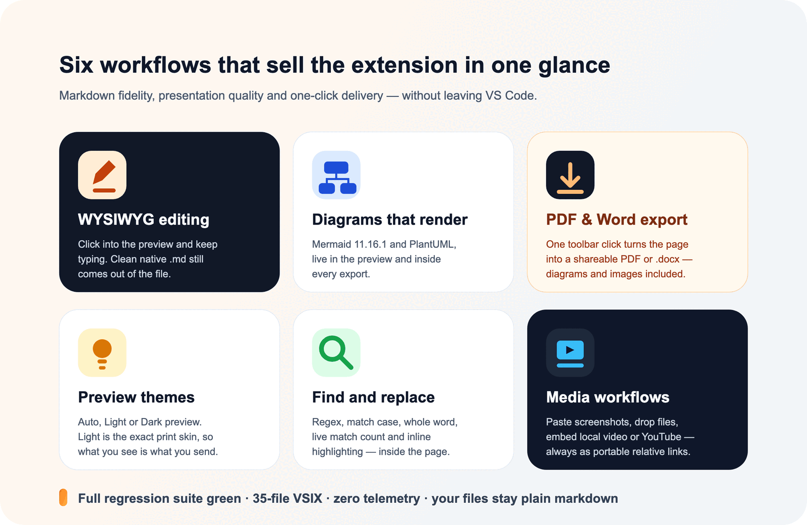

The extension is designed to remove the usual markdown tradeoff: you do not have to choose between fast writing, structured content, and a presentation-friendly result. The workflow stays visual and efficient while the files remain standard `.md` documents.

## What is new in this release

| Highlight | What it means for you |
| --- | --- |
| **Export to PDF & Word** | An Export split-button on the toolbar renders the current document to PDF (system Chrome/Edge headless) or `.docx`. Mermaid diagrams and local images are carried into both formats. |
| **Preview theme: Auto · Light · Dark** | A lightbulb menu re-skins the preview pane only — your VS Code theme is never touched. |
| **Readable light skin, print parity** | Forced Light uses the *exact* palette of the export stylesheet, so the preview is a true proof of the PDF and the Word file. Tables, quotes, rules, code blocks, and all Mermaid diagram types follow along. |
| **Outline navigation** | A Word-style left navigation next to the view toggle lists every heading of the rendered document, tracks the scroll position, and jumps on click. Preview mode only. |
| **Reload from disk** | One button re-reads the file when an AI agent, a `git checkout`, or another editor writes it underneath you — undoable, and safe while WYSIWYG is active. |
| **Mermaid 11.16.1** | The current Mermaid line, verified across 13 diagram types, including `block-beta`, `architecture-beta`, and mindmaps. Author-defined colors are honoured. |
| **Hardened toolchain** | Integration tests run on VS Code 1.133, the VSIX is down to 35 clean files, and `npm audit` went from 18 findings to 2 documented, accepted ones. |

## Install in under a minute

This repository ships the packaged extension at the root, in two formats — use the `.zip` when your mail or chat channel blocks `.vsix` attachments:

- `concept-lab-vsc-markdown-editor.vsix`
- `concept-lab-vsc-markdown-editor.zip` (contains the same VSIX)

Install it in VS Code like this:

1. Open VS Code.
2. Go to Extensions.
3. Open the `...` menu in the Extensions view.
4. Choose **Install from VSIX...**.
5. Select `concept-lab-vsc-markdown-editor.vsix` from the root of this repository.

If you prefer the command line:

```bash
code --install-extension ./concept-lab-vsc-markdown-editor.vsix
```

### Make it the default editor for markdown

Add this to your VS Code `settings.json`:

```json
{
  "workbench.editorAssociations": {
    "*.md": "conceptLabMdVisualPreview.editor"
  }
}
```

## The user interface

### Real interface preview

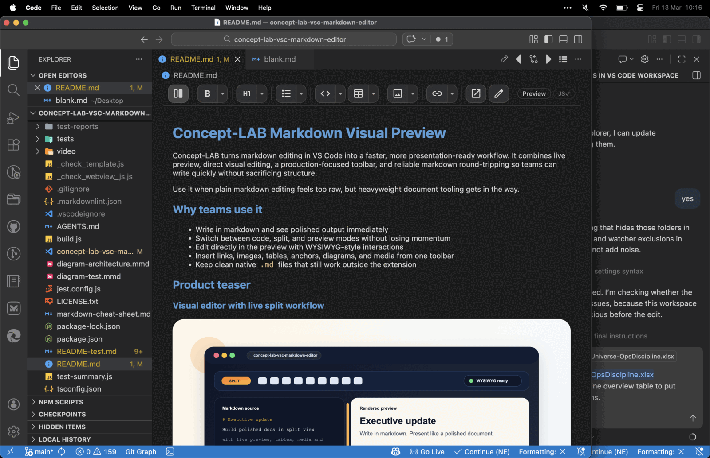

Concept-LAB gives authors a markdown workspace that feels like an editor and a review surface at the same time: a real toolbar, clear mode switching, and immediate visual feedback inside the document.

*The live captures in this section were taken before the Export, Preview theme, and Reload buttons were added — see [the toolbar section](#the-complete-toolbar-button-by-button) for the current strip.*

### View modes in the actual UI

| Screenshot | What you are seeing |
| --- | --- |
| 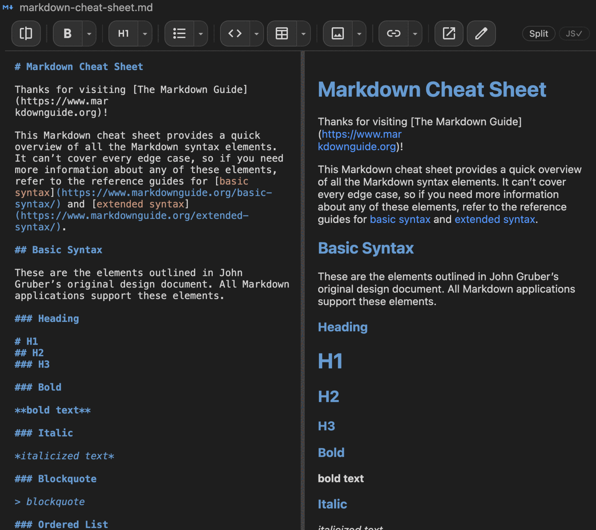 | **Split view** keeps markdown source and rendered output visible together. This is the best mode for writing while continuously checking layout, links, headings, and overall presentation. |
| 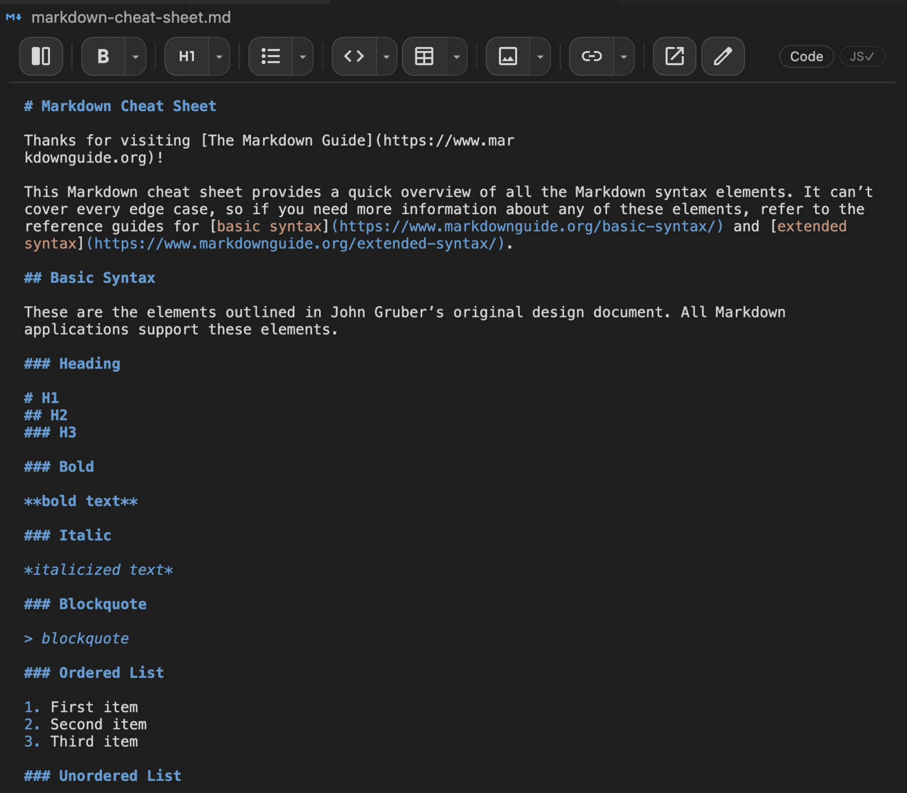 | **Code view** focuses fully on raw markdown. Use it when you want uninterrupted text editing, precise syntax control, or structured content cleanup. |
| 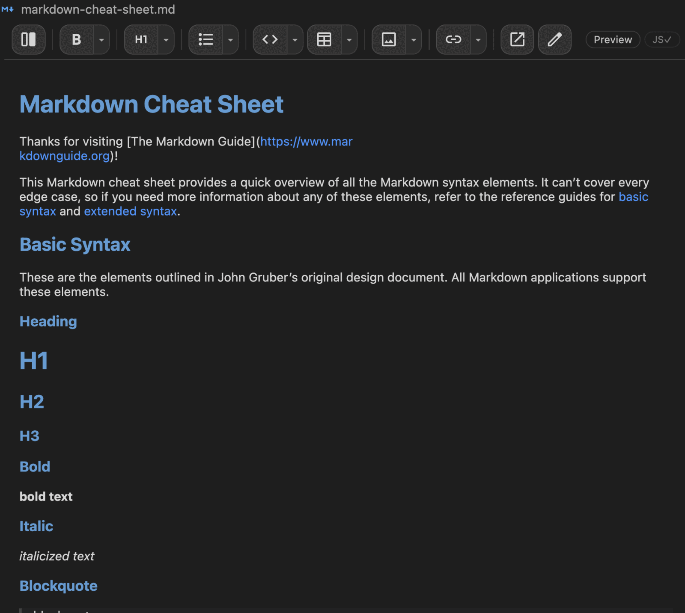 | **Preview view** focuses on the rendered document. This is the cleanest reading and review mode when you want to inspect the final visual result. |

Your mode choice is remembered across sessions, synced across open markdown tabs, and the split ratio is persisted when you drag the divider.

### The complete toolbar, button by button

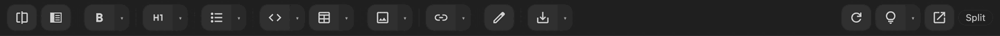

Left to right: view toggle · **outline navigation** · text styles · headings · lists · code block · table · media · links · WYSIWYG · **Export** — then, pinned to the right edge: **Reload from disk** · **Preview theme** · Open in native editor · mode badge. Every icon above is the actual SVG shipped in `media/icons`, drawn at the real button size.

The three right-edge actions carry no overflow priority, so they stay reachable at any window width. Everything left of the spacer collapses into a `⋯` menu when the editor gets narrow, lowest priority first.

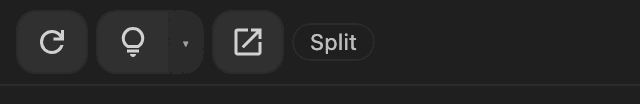

An earlier live capture of the same toolbar, before Export, Preview theme, and Reload were added:

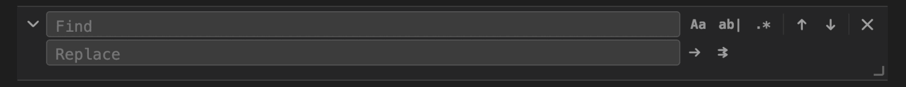

## UI component guide

### View mode controls

| Component | Screenshot | Purpose |
| --- | --- | --- |
| Split mode button | 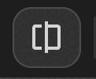 | Opens the side-by-side editing layout with markdown on one side and preview on the other. |
| Code mode button | 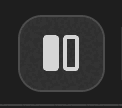 | Switches to a markdown-first editing surface for focused source editing. |
| Preview mode button | 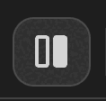 | Switches to a rendered-document view for reading and visual review. |

### Formatting and structure controls

| Component | Screenshot | Purpose |
| --- | --- | --- |
| Text style menu | 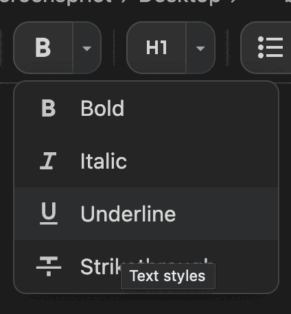 | Applies inline formatting actions such as bold, italic, underline, and strikethrough. |
| Heading menu | 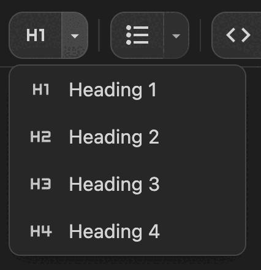 | Promotes content into heading levels so documents stay structured and easy to scan. |
| List menu | 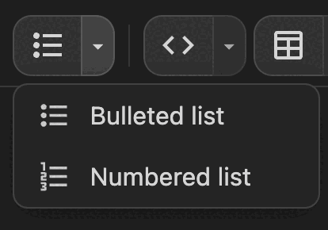 | Switches between bulleted and numbered lists for clear content hierarchy. |

### Content insertion controls

| Component | Screenshot | Purpose |
| --- | --- | --- |
| Code block language menu | 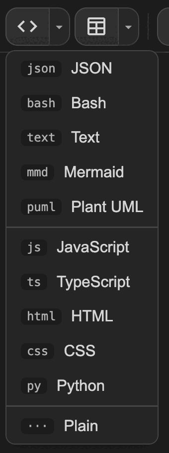 | Inserts fenced code blocks with language presets such as JSON, Bash, Mermaid, PlantUML, TypeScript, HTML, CSS, and Python — always at the active caret. |
| Table size picker | 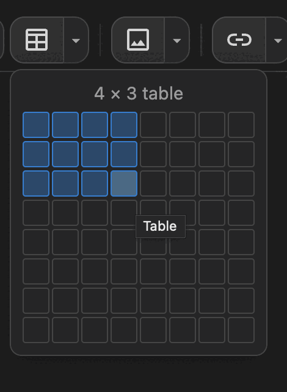 | Creates markdown tables visually instead of typing the pipe structure by hand. |
| Media insert menu | 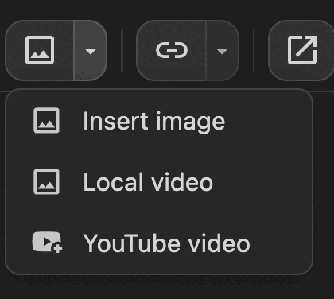 | Inserts images, local videos with inline playback, and YouTube-driven media workflows from one control. |
| Link and TOC menu | 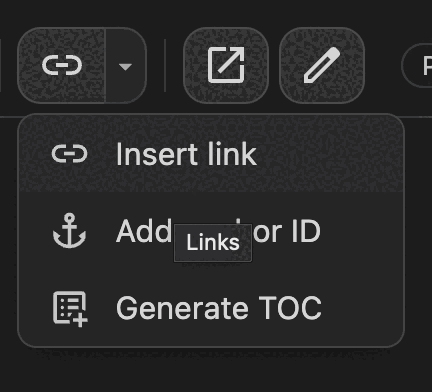 | Handles link insertion, anchor IDs, and table-of-contents generation from the toolbar. |

### Delivery and preview controls

These are the newest additions to the toolbar, pinned to the right edge where they never collapse.

| Component | Screenshot | Purpose |
| --- | --- | --- |
| Export split-button | 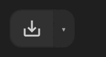 | Exports the current document. The main button repeats your last format; the chevron opens the format menu. |
| Export menu | 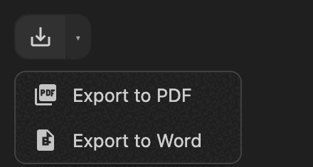 | **Export to PDF** renders through system Chrome/Edge headless. **Export to Word** produces a Calibri-styled `.docx`. Mermaid diagrams and local images travel into both. |
| Outline navigation |  | Toggles the left navigation pane listing the document headings (H1-H6), indented by level. The entry under the top of the pane stays highlighted while you scroll, clicking one scrolls the preview there, and the right edge of the pane drags to resize. Enabled in preview mode only — greyed out in split and code view. |
| Reload from disk | 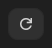 | Re-reads the file when an AI agent, `git checkout`, or another editor changed it underneath you. The icon spins during the round-trip, the previous buffer stays in undo history, and WYSIWYG keeps its caret and scroll position. |
| Preview theme | 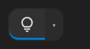 | Opens the preview skin menu. An accent bar under the icon signals that a manual override is active. |
| Preview theme menu | 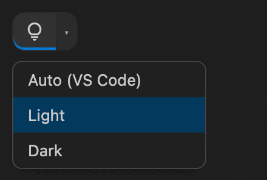 | **Auto** follows VS Code, **Light** paints the exact export/print skin, **Dark** forces a dark page. The preview pane only — your VS Code theme is never touched, and Mermaid diagrams repaint with the palette. |
| Open in native editor |  | Opens the same file side by side in the stock VS Code editor, with scroll sync, for anything that needs the full extension ecosystem. |

### Search and editing assistance

| Component | Screenshot | Purpose |
| --- | --- | --- |
| Toolbar with inline find/replace | 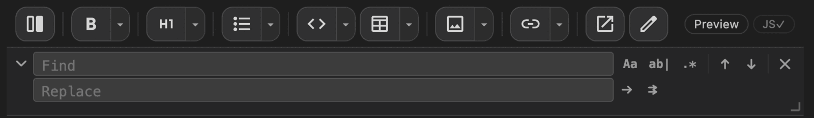 | Shows how search is available directly within the editor UI without leaving the document context. |
| Expanded find/replace panel | 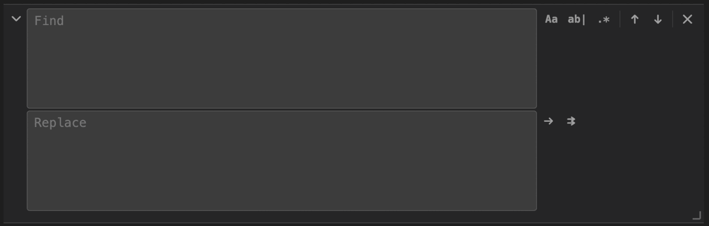 | Exposes the full search workflow including replace, case sensitivity, whole-word matching, regex, and navigation controls. |

### Workspace context around the editor

| Component | Screenshot | Purpose |
| --- | --- | --- |
| Explorer with markdown files | 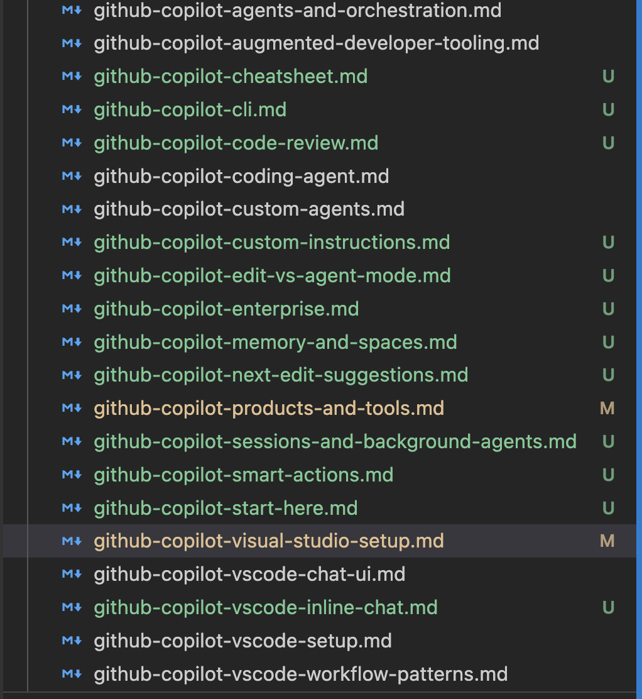 | Shows the extension working inside a real VS Code workspace where markdown documents remain normal project files. |
| Preview mode with Explorer visible | 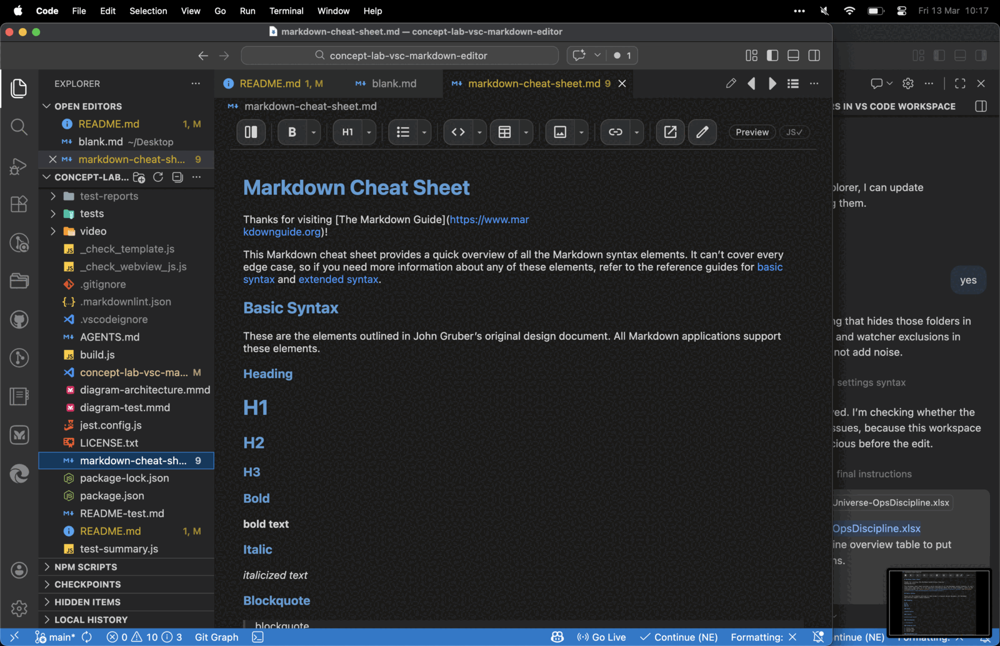 | Shows how the extension still feels native inside the VS Code layout while providing its own markdown-focused interface. |

## What you get

### View modes and layout

- Three modes: Split, Code-only, Preview-only
- Mode persistence across sessions and mode sync across open markdown tabs
- Resizable split pane with persisted ratio
- Sticky, responsive toolbar that collapses low-priority actions into a `⋯` overflow menu

### Editing experience

- Live editing with syntax highlight overlay and line numbers in code view
- Smart Enter for list continuation and ordered list increment
- Tab and Shift+Tab indent and dedent behavior, in code view and in lists and tables
- Markdown helpers for headings, emphasis, links, images, and fenced code blocks
- Three-tier autocomplete: document words, 17 markdown snippets, and the VS Code language server
- Fenced code blocks carry a language badge in the preview, so structure stays readable at a glance
- Custom right-click menu with formatting and clipboard actions

### WYSIWYG mode

- Click into preview to edit rendered content directly
- Toolbar actions continue to work in visual mode
- Debounced sync back to markdown source
- Robust HTML-to-markdown serialization for headings, lists, tables, links, images, and code
- Mermaid and PlantUML sources survive every preview ↔ code switch

### Toolbar and insertions

- Formatting actions: bold, italic, underline, strikethrough, headings, lists
- Insertions: links, images, local video, code blocks, tables, YouTube thumbnails
- Link modal with two modes: type a URL, or search existing anchors across the page, the folder, or the whole workspace with fuzzy scoring
- Anchor utilities for stable `NNNN--page--slug` IDs, plus `{#custom-id}` on any heading
- TOC generation and update, with `[ TOP ]` back-navigation injected per section
- Table picker with a visual grid instead of hand-typed pipes
- Language presets for `text`, `json`, `bash`, `typescript`, `html`, `css`, `python`, `mermaid`, and `plantuml` — always inserted at the active caret

### Presentation and delivery

- **Preview theme** — Auto (follows VS Code), Light, or Dark, applied to the preview pane only
- **Light equals print** — the same `#ffffff` page, `#2c3e50` headings, `#3498db` links, and `#f5f5f5` code as the export stylesheet
- **Export to PDF** — via system Chrome, Edge, Chromium, or Brave in headless mode; no extra npm dependency, no cloud round-trip
- **Export to Word (DOCX)** — Calibri-based styling, Mermaid diagrams rasterised to PNG, local images embedded
- Print-hardened CSS: exact background colors on paper, no page breaks inside code blocks, quotes, tables, diagrams, or images, and repeated table headers

### Diagram, search, and media workflows

- Mermaid 11.16.1 fences render in preview, in PDF, and in Word — 13 diagram types verified end to end: flowchart, graph, sequence, class, state, ER, gantt, pie, mindmap, journey, `block-beta`, `architecture-beta`, and author-themed diagrams
- Readable palettes are defined for every diagram family, including git graph, quadrant, and XY charts, so nothing falls back to washed-out defaults on a white page
- Diagrams follow the preview palette automatically; a `%%{init}%%` block with `theme: "base"` keeps your own colors instead
- PlantUML and PUML fences render as SVG previews
- Inline find and replace with regex, match case, whole word, live match count, and highlighting
- Paste images from the clipboard or drag and drop them into the document — they land in `images/` with a timestamped name and a relative link, so the document stays portable
- Local video files play inline in the preview; YouTube links become thumbnails that open an in-place player

### Productivity and interoperability

- Outline navigation pane in preview mode — heading tree, scroll tracking, click to jump
- Reload from disk when an agent or another tool rewrites the file — full undo history preserved
- Code-to-preview and native-editor-to-preview scroll synchronization
- Every heading gets a stable slug ID automatically, so TOC and `#anchor` links always resolve
- Anchor-aware link handling: a `.md#anchor` link scrolls within the page when it points at itself, and opens the other file in a new tab when it does not
- Peek at referenced files — clicking a link to a local non-markdown file opens its content in an inline popup instead of leaving the document
- Native editor interop when switching between Concept-LAB and the default markdown editor

## Keyboard shortcuts

All shortcuts are scoped to the Concept-LAB editor, so they never hijack the terminal, Copilot Chat, or other webviews. They work in code view and in WYSIWYG mode alike.

| Shortcut | Action |
| --- | --- |
| `Cmd/Ctrl+S` | Save |
| `Cmd/Ctrl+Z` | Undo |
| `Cmd/Ctrl+Shift+Z` or `Cmd/Ctrl+Y` | Redo |
| `Cmd/Ctrl+B` | Bold |
| `Cmd/Ctrl+I` | Italic |
| `Cmd/Ctrl+U` | Underline |
| `Cmd/Ctrl+F` | Find |
| `Cmd/Ctrl+H` | Replace |
| `Cmd/Ctrl+A` | Select all |
| `Cmd/Ctrl+C` / `X` / `V` | Copy / Cut / Paste |
| `Ctrl+Shift+W` | Toggle WYSIWYG |
| `Ctrl+Space` | Force autocomplete |

## GitHub Copilot integration

The extension also contributes markdown-aware Copilot workflows:

- Chat participant: `@in-md`
- `#in-md` lists open markdown documents
- `#in-mds` scans markdown files in the current document folder
- `#in-md-file` fetches the content of a specific markdown file
- Agent mode support for tool-driven markdown tasks

## Good to know

Honest limits, so nothing surprises you in production:

- Very deeply nested structures (multi-level lists with mixed content, nested blockquotes) can lose some nuance in the WYSIWYG round-trip. Code view always keeps the exact source.
- Find and replace works on the markdown source, so matches are not highlighted while WYSIWYG is active. Regex *replace* still has a known edge case.
- Scroll sync is percentage-based, so tall images and large diagrams make the mapping approximate.
- PDF export needs Chrome, Edge, Chromium, or Brave installed. There is no bundled browser and nothing is uploaded anywhere.

## Spec sheet

| Item | Value |
| --- | --- |
| Extension version | 1.0.19 |
| Minimum VS Code | 1.109.0 |
| Editor view type | `conceptLabMdVisualPreview.editor` |
| Renderer | markdown-it 14 with HTML, linkify, and hard line breaks |
| Diagrams | Mermaid 11.16.1 (bundled, offline) and PlantUML via encoder |
| Word export | `html-to-docx` 1.8 |
| PDF export | System Chrome / Edge / Chromium / Brave, headless |
| Commands | 14, including `conceptLab.exportPdf` and `conceptLab.exportDocx` |
| Copilot surface | 1 chat participant, 3 language model tools |
| Automated checks | Jest unit suite (guardrails, webview structure, helpers) plus VS Code integration tests |
| Packaged artifact | 35-file VSIX, ~2.3 MB, plus a `.zip` wrapper |
| Telemetry | None |

## Build and validation

If you want to rebuild or refresh the extension artifact yourself:

```bash
npm install
npm run compile
npm test
npm run test:integration
npm run package
```

`npm run package` produces both `concept-lab-vsc-markdown-editor.vsix` and `concept-lab-vsc-markdown-editor.zip`.

The documentation artifacts regenerate themselves too:

```bash
npm run readme:pdf                     # rebuild README.pdf through the real export pipeline
node scripts/make-toolbar-shots.js     # redraw the toolbar art from media/icons
```

## Repository notes

- Main implementation lives in `src/extension.ts`
- Testable helpers live in `src/testable.ts`
- Unit tests live in `tests/unit`, integration tests in `tests/integration`
- Agent orchestration and the full feature changelog live in [.github/](.github/README.md) and [.claude/](.claude/README.md)

---
